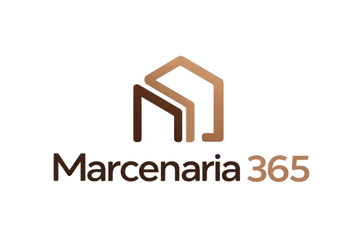
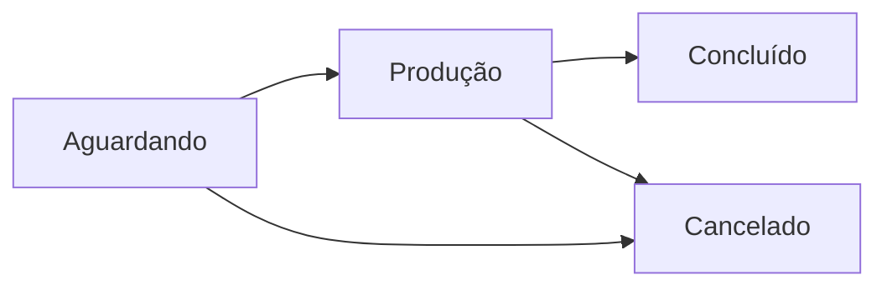
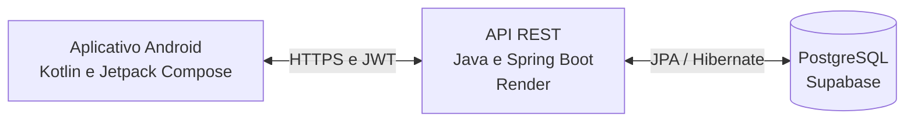

<div align="center">



# Marcenaria 365

**Do orçamento ao recebimento, tudo organizado.**

Projeto Integrador V — Grupo NEXO  
Tecnologia em Sistemas para Internet — Senac  
2026


</div>

---

## Sobre o projeto

O Marcenaria 365 é um aplicativo Android desenvolvido
pelo Grupo NEXO para auxiliar marceneiros autônomos
na organização e na gestão de suas atividades
profissionais.

A solução centraliza informações relacionadas a
clientes, serviços, materiais, orçamentos e
movimentações financeiras, proporcionando uma
experiência de gestão direcionada às necessidades
dos profissionais da marcenaria.

O projeto foi desenvolvido no contexto do Projeto
Integrador V do curso de Tecnologia em Sistemas
para Internet do Senac.

## Status do projeto

**MVP finalizado para entrega acadêmica — 2026.**

A versão apresenta as funcionalidades essenciais
propostas para a organização e gestão de pequenos
negócios da marcenaria.

As melhorias futuras estão documentadas
separadamente e não fazem parte do escopo
funcional desta versão.

## Comunidade

A comunidade atendida pelo projeto é representada
pelo marceneiro autônomo Nilton César, profissional
que atua na produção de móveis sob medida, na
região do Jardim Luso, em São Paulo.

A partir do contato com sua realidade profissional,
foram identificadas oportunidades de digitalização
e melhoria na organização das atividades
administrativas da marcenaria.

## Problema identificado

- Informações de clientes dispersas.
- Orçamentos elaborados manualmente.
- Dificuldade na organização de materiais.
- Falta de controle centralizado de recebimentos.
- Dificuldade no acompanhamento de serviços e prazos.
- Dependência de registros em papel.

## Solução proposta

O Marcenaria 365 reúne recursos administrativos
em um único aplicativo, permitindo que o
profissional acompanhe sua rotina de trabalho
de maneira organizada.

A proposta é simplificar a gestão da marcenaria,
reduzindo a dependência de registros manuais.

## Funcionalidades

### Autenticação e conta

- Cadastro de usuário.
- Login com e-mail e senha.
- Autenticação por token JWT.
- Perfil do usuário.
- Encerramento de sessão.

### Painel inicial

- Resumo das informações da marcenaria.
- Visualização do saldo total.
- Indicadores de clientes cadastrados.
- Indicadores de serviços.
- Gráfico de distribuição dos serviços por situação.

### Clientes

- Cadastro de clientes.
- Consulta de informações cadastrais.
- Edição de registros.
- Gerenciamento dos clientes vinculados ao usuário.

### Serviços

- Cadastro e gerenciamento de serviços.
- Acompanhamento dos prazos de entrega.
- Consulta dos detalhes dos serviços.
- Registro de valores e recebimentos.
- Organização dos serviços por situação.

O fluxo principal de acompanhamento é:



Os serviços cancelados possuem uma classificação
separada do fluxo principal de execução.

### Orçamentos

- Elaboração de orçamentos digitais.
- Inclusão de itens e materiais.
- Registro de valores e condições comerciais.
- Consulta dos detalhes do orçamento.
- Compartilhamento de propostas.
- Exclusão mediante confirmação.

### Materiais

- Cadastro de materiais.
- Consulta dos materiais cadastrados.
- Organização das informações e valores
  relacionados aos materiais utilizados.

### Carteira e controle de caixa

- Registro de entradas financeiras.
- Registro de saídas financeiras.
- Visualização do saldo total.
- Consulta de movimentações.
- Acompanhamento financeiro por período.

O módulo financeiro possui caráter gerencial.
O aplicativo não realiza transações bancárias
nem processa pagamentos diretamente.

### Configurações e informações

- Perfil do usuário.
- Termos de uso.
- Política de privacidade.
- Ajuda e suporte.
- Encerramento de sessão.

## Tecnologias utilizadas

### Front-end

| Tecnologia | Finalidade |
|---|---|
| Kotlin | Desenvolvimento Android |
| Jetpack Compose | Construção da interface |
| Material Design 3 | Componentes de interface |
| Android Studio | Ambiente de desenvolvimento |
| Gradle | Compilação e dependências |

### Back-end

| Tecnologia | Finalidade |
|---|---|
| Java | Desenvolvimento da API |
| Spring Boot | Estrutura da aplicação |
| Spring Security | Controle de acesso |
| JWT | Autenticação |
| BCrypt | Proteção de senhas por hash |
| JPA/Hibernate | Persistência de dados |
| API REST | Comunicação com o aplicativo |

### Banco de dados e infraestrutura

| Tecnologia | Finalidade |
|---|---|
| PostgreSQL | Banco de dados relacional |
| Supabase | Hospedagem do banco de dados |
| Render | Hospedagem da API |

### Ferramentas complementares

| Ferramenta | Finalidade |
|---|---|
| Git | Controle de versão |
| GitHub | Repositório e colaboração |
| Figma | Prototipação da interface |
| Canva | Apresentação do projeto |

## Arquitetura do sistema

O Marcenaria 365 utiliza uma arquitetura
cliente-servidor, com separação entre interface,
regras de negócio e persistência de dados.



O aplicativo Android realiza requisições à API
REST, responsável pela autenticação, pelo
processamento das regras de negócio e pela
comunicação com o banco de dados.

O aplicativo não acessa diretamente o banco
de dados PostgreSQL.

## Segurança

O projeto incorpora mecanismos de segurança
voltados à proteção das contas e das informações
cadastradas.

- Autenticação utilizando JWT.
- Proteção de senhas por hash BCrypt.
- Controle de acesso com Spring Security.
- Comunicação com a API por HTTPS.
- Restrição de acesso aos recursos protegidos.
- Associação dos registros ao usuário autenticado.
- Encerramento da sessão local.

Esses mecanismos não substituem auditorias
especializadas de segurança para uma futura
utilização comercial.

## Privacidade e LGPD

O desenvolvimento considera princípios da Lei
Geral de Proteção de Dados Pessoais (LGPD),
Lei nº 13.709/2018.

O aplicativo disponibiliza documentos de Termos
de Uso e Política de Privacidade, com informações
sobre a utilização da aplicação e o tratamento
dos dados pessoais.

As informações cadastradas destinam-se à
organização das atividades profissionais
do usuário.

Por se tratar de um projeto acadêmico, a
utilização comercial deverá ser precedida
de avaliações jurídicas, técnicas e de segurança
complementares.

## Acessibilidade

A construção da interface considera boas
práticas de acessibilidade e usabilidade,
buscando facilitar a interação com o aplicativo.

Entre os aspectos considerados estão:

- Organização visual das informações.
- Legibilidade dos textos.
- Identificação das ações por ícones e textos.
- Descrições de acessibilidade em componentes.
- Mensagens de confirmação para ações destrutivas.
- Navegação organizada entre os módulos.
- Utilização de cores associadas a informações
  textuais na identificação dos estados.

A validação integral com tecnologias assistivas
permanece uma oportunidade de evolução.

## Diferenciais

O principal diferencial do Marcenaria 365 é
sua proposta direcionada à realidade dos
marceneiros autônomos.

- Gestão especializada para o segmento.
- Interface objetiva e organizada.
- Centralização das informações.
- Acompanhamento dos serviços e recebimentos.
- Desenvolvimento fundamentado nas necessidades
  identificadas junto à comunidade.

## Modelo de negócio

O Marcenaria 365 possui uma proposta de modelo
de negócio B2B, direcionada aos profissionais
autônomos e às pequenas marcenarias.

Como possibilidade de evolução comercial,
considera-se um modelo de assinatura mensal
(SaaS).

As estratégias de divulgação propostas incluem:

- Redes sociais.
- Parcerias com profissionais do segmento.
- Indicações de usuários.
- Divulgação junto à comunidade.

A monetização representa uma proposta futura
e não está implementada no MVP acadêmico.

## Impacto social e ODS

O projeto está alinhado ao Objetivo de
Desenvolvimento Sustentável 8 da Organização
das Nações Unidas.

**ODS 8 — Trabalho Decente e Crescimento Econômico.**

Especialmente à meta 8.3, relacionada ao
empreendedorismo e ao desenvolvimento de
micro e pequenas empresas.

### Impactos esperados

- Inclusão digital de profissionais autônomos.
- Incentivo ao empreendedorismo.
- Redução da dependência de registros em papel.
- Melhoria na organização das atividades.
- Maior autonomia na gestão profissional.

Esses impactos representam objetivos da
solução, não resultados econômicos mensurados.

## Testes e validações

Durante o desenvolvimento foram realizados
testes de compilação, autenticação, comunicação
com a API e isolamento de registros.

Entre os cenários documentados estão:

| Cenário | Resultado registrado |
|---|---|
| Compilação Android com assembleDebug | Aprovado |
| Login pela API com duas contas de teste | Aprovado |
| Requisição sem autenticação para clientes | HTTP 401 |
| Consulta autenticada de clientes | Aprovado |
| Cadastro de cliente pela API | Aprovado |
| Acesso a cliente vinculado a outra conta | HTTP 404 |
| Consulta de cliente após exclusão | HTTP 404 |

Os resultados correspondem aos cenários
verificados durante o desenvolvimento e não
representam certificação integral de qualidade,
segurança ou acessibilidade.

## Estrutura do projeto

```text
Marcenaria365/
├── app/
│   └── src/
│       └── main/
│           ├── java/
│           │   └── com/nexo/marcenaria365/
│           └── res/
├── backend/
│   └── marcenaria365-api/
├── gradle/
├── gradlew
├── gradlew.bat
└── README.md
```

## Como executar

### Pré-requisitos

- Git.
- Android Studio.
- Android SDK compatível com o projeto.
- JDK compatível com o Gradle.
- Emulador ou dispositivo Android.
- Conexão com a internet para utilização da API.

### Clonar o repositório

```bash
git clone https://github.com/wanessags/Marcenaria365.git
```

### Executar o aplicativo

1. Abra o projeto no Android Studio.
2. Aguarde a sincronização do Gradle.
3. Selecione um emulador ou dispositivo Android.
4. Execute o módulo app.

Para gerar a versão de depuração pelo
PowerShell do Windows:

```powershell
.\gradlew.bat :app:assembleDebug
```

Para instalar em um dispositivo conectado
ou emulador iniciado:

```powershell
.\gradlew.bat :app:installDebug
```

### Back-end

O código da API está disponível no diretório:

```text
backend/marcenaria365-api
```

A execução local requer a configuração das
variáveis de ambiente e da conexão com o
banco de dados PostgreSQL.

Credenciais, senhas e chaves de autenticação
não devem ser publicadas no repositório.

### API hospedada

```text
https://marcenaria365-api.onrender.com
```

A API hospedada no Render pode apresentar
demora na primeira resposta após períodos
de inatividade.

## Limitações e melhorias futuras

Apesar da conclusão do MVP acadêmico,
foram identificadas oportunidades de evolução:

- Integração com Cloudinary para armazenamento
  permanente de imagens.
- Disponibilização operacional da recuperação
  de senha por e-mail.
- Ampliação dos testes automatizados.
- Validação complementar da acessibilidade.
- Implementação de notificações de prazos,
  entregas e recebimentos.
- Ampliação dos relatórios gerenciais.
- Melhorias de desempenho e disponibilidade.
- Avaliação dos requisitos para utilização
  comercial.

Esses itens não são apresentados como
funcionalidades concluídas nesta versão.

## Equipe

### Grupo NEXO

| Integrante | Área de atuação |
|---|---|
| Francisco Arthur | Back-end e documentação |
| Felipe Freitas | Back-end e documentação |
| Wanessa Gonçalves | Front-end e documentação |

## Instituição

**Centro Universitário Senac**

Curso: Tecnologia em Sistemas para Internet  
Disciplina: Projeto Integrador V  
Ano: 2026  

Projeto acadêmico desenvolvido com foco na
aplicação prática de conhecimentos em
desenvolvimento de software, banco de dados,
computação em nuvem, experiência do usuário
e gestão de projetos.

---

<div align="center">


### A marcenaria cria. O NEXO organiza.

**Do orçamento ao recebimento, tudo organizado.**

Desenvolvido pelo Grupo NEXO — Senac, 2026.

</div>
